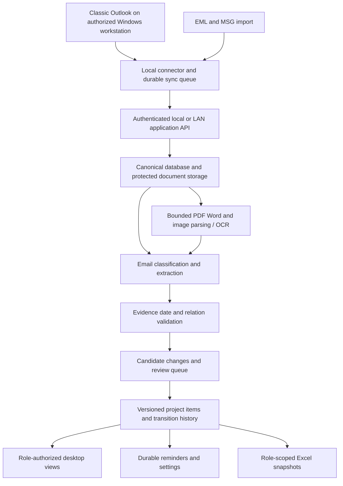

# Project review and agent delivery plan — 11 October 2026

Reviewed repository: `f31e2ab5e936688e7525ab2d5776f069cd181ff8`.
This is a review and implementation plan, not a claim that the proposed features
have been implemented. Three GPT-6 Luna xhigh agents supplied initial audit
notes before the owner requested no further delegation. The primary assistant
then independently reproduced all six defect categories below, including
transitive reply grouping, and finalized this review directly. Future work under
this plan is assigned to the primary assistant without subagents.

## Decision and authoritative scope

**Keep the project and its useful foundation. Change the delivery priorities.**
The existing implementation is an email archive and research prototype. It does
not yet deliver the complete project-management workflow in the revised proposal.
More model experiments alone will not close that gap.

The owner clarified on 11 October that **FYP Proposal Revised.pdf is the new
scope**, submission is in **January**, and an **AI agent will perform development**.
This plan assumes January 2027 and targets a release by **31 December 2026**,
with feature freeze on **20 December**. The exact January date is not known.
These are proposed delivery checkpoints, not guarantees of elapsed development
time or automatic authorization to run scheduled future jobs.

The revised proposal, pages 4–8, requires all of the following:

- Windows desktop application with classic Outlook integration.
- English email classification and structured information extraction.
- **Content extraction from Word, PDF, and scanned-image attachments.**
- Project meetings, deadlines, actions, documents, inputs and follow-up tracking.
- Excel recordkeeping and a central dashboard, reminders, and settings.
- **Senior-manager, project-manager and team-member access/views.**
- **Single-user and multi-user operation over a local network.**

The filename-only attachment restriction and single-user delivery assumptions in
earlier instructions are superseded for the final delivery. Preserve those older
reports as historical evidence; do not represent their completed work as meeting
the expanded requirements. Keep offline inference and local/LAN operation. The
annotation website remains a research tool, not the production LAN application.

## Evidence and readiness

| Area | What is supported by evidence | What remains unproved or absent |
|---|---|---|
| Email archive | Real EML/JSONL round trips through SQLite, Excel and PySide were documented on 10 October. Today's 34 desktop tests pass. | Real classic Outlook and standalone MSG interoperability were previously only mocked. Cross-adapter identity and chronological/thread ordering have defects below. |
| Annotation | Versioned direct v1.1, exact source evidence, drafts, frozen independent submissions, isolated historical formats. | Three-person completion is not enforced; adjudication is unfinished. Last recorded live audit on 10 October had zero v1.1 reviews. Live counts were not refreshed for this review. |
| Classifier | Frozen 668-email Enron AI-silver benchmark and reproducible inference. | No demonstrated accuracy on independently adjudicated emails representing the final users. |
| Extraction | Sparse exact-text rule cues; historical compact and GLiNER benchmarks. | Current product does not implement all 11 target types semantically, resolve dates, link owners/dates to items, or process attachment content. |
| Project management | An email/thread archive exists. | Reviewed item ledger, state changes, missing-document logic, durable reminders and operational correction workflow are missing. |
| Expanded scope | Proposal and owner confirmation establish the requirement. | Production login/authorization, LAN backend, attachment parsers/OCR and role-specific views are not implemented. |

The previous 44-message smoke test produced 8 REVIEW and 36 ABSTAIN statuses,
and seven extraction suggestions. Those figures measure execution/coverage, not
correctness. The earlier 30-message EML and JSONL checks reused the same emails.
They must not be counted as independent evaluation samples.

### Model evidence does not justify unattended use

The [classification report](ai_silver_model_optimization.md) records ensemble
TEST micro/macro F1 of **0.6522/0.4117**, versus **0.6982/0.4033** for the matched
TF-IDF reference. The ensemble detected only **1/17 ACTION_REQUEST** positives,
versus 10/17 for the reference. Four rare labels have only 1–3 TEST positives.
The intervals for ensemble-minus-reference differences include zero. These
are AI-silver reference scores, not human accuracy percentages.

There were **293 DEV configuration/calibration entries on 104 DEV emails**.
This creates substantial model-selection uncertainty. Preserve the results and
closed TEST; do not select a new winner using its already observed scores.
Use a small, predeclared comparison on future suitable development data.

The [MailEx report](mailex_extraction_final.md) records compact argument-role
F1 **0.339138**, exact-record F1 **0.199578**, and exact-record precision **0.168449**.
GLiNER Small FT trails it. Those results concern the MailEx task, not the current
FYP schema. Decision D rejecting unattended extraction remains justified.

## Concrete defects to fix first

All reproduced examples below were synthetic. Severity reflects their effect
on the intended product; current suggestions are already marked REVIEW.

| Priority | Finding and evidence | Required correction and regression gate |
|---|---|---|
| P1 | **Attached emails contaminate current-message evidence.** `desktop/local_product/adapters.py:58–94` walks into attached `message/rfc822` parts. An outer message saying “For reference only.” with an attached `.eml` containing an approval request returned both as current text and no attachment filename. | Traverse MIME with attachment ancestry; preserve the attachment name and separate document evidence. A nested email must never become the outer author's instruction. Cover nested MIME, attached HTML and filenames. |
| P1 | **Duplicate messages across import formats.** Adapter-specific IDs and `source_id` as the sole primary key allow an EML and JSONL with the same Message-ID to become two rows. See `adapters.py:151`, `:280`, `:424`, `models.py:340`, `store.py:81`. | Separate canonical message identity from per-adapter observations. Use Message-ID plus collision checks; handle missing/reused IDs explicitly. Preserve distinct mailbox visibility grants. Replaying EML/MSG/Outlook/JSONL views of one message must not create duplicate tasks or reminders. |
| P1 | **Timezone ordering is incorrect.** `store.py:294–305` uses string MIN/MAX/sort; parsers preserve offsets. `10:00+05:00` is earlier than `06:00Z` but was treated as later. | Store original sent/received values and normalized UTC instants separately. Define missing/naive-zone policy; quarantine ambiguity. Test offsets, midnight, DST, invalid dates and date-only deadlines. |
| P1 | **Replies can split into different threads.** `adapters.py:141` prefers raw Thread-Index. Valid base64 parent/child Thread-Index headers with the same References root produced different canonical threads. `models.py:114` also lacks transitive resolution for multi-hop In-Reply-To-only chains. | Maintain an explicit reply graph and conversation aliases across formats. Resolve late-arriving ancestors and multi-hop replies. Do not equate a thread with one project item; it can contain several tasks. |
| P1 | **Predictions survive changed source text.** `store.py:242–247` keeps classifier fields on reimport without a classifier while replacing the input text. A synthetic APPROVAL prediction survived a change to “Thanks, received.” | Bind every extraction/classification to source revision and input hash, schema, model and settings. Invalidate derived outputs on change; preserve reviewed decisions with an explicit conflict, never silently overwrite them. |
| P1 | **Inline replies lose new instructions.** `preprocessing.py:38–61` truncates at the first quote. `> Can we submit on Friday?` followed by `No, the deadline is Monday.` yielded an empty current message. | Segment authored and quoted ranges instead of treating everything after the first quote as history. Preserve raw text; mark uncertain boundaries for review. Test top-, bottom- and interleaved replies against labeled parser fixtures. |

Known missing capabilities are separate from defects: `ui.py:177–204` imports
synchronously, only the default Inbox is supported, and the viewer has no
reviewed-item editing. Add background work, progress/cancellation, folder
selection, checkpoints and recovery before using it on a real mailbox.

## What to keep and what to change

**Keep:** the eight direct labels, eleven optional extraction targets, auxiliary
EVIDENCE, exact-source validation, provenance, research version boundaries,
SQLite as a local transactional store, Excel export, PySide, simple baselines,
and clear REVIEW/ABSTAIN behavior. These are useful foundations.

**Change the unit of success to the project item and its history.** A message
label does not tell the system whether a deadline creates a task, moves an
existing task, or belongs to a different task in the same thread. Entity spans
alone do not tell which person owns which action.

For example, the system must track a request for a report due Friday, a later
extension to Monday, an owner change, and delivery of the report as one evolving
item with evidence for each change. An unrelated Friday meeting in the same
thread must remain separate. Reimporting those messages must change nothing.

Do not replace v1.1 or add a mandatory abstract annotation layer. Introduce a
**separately versioned product item/transition schema**, and later a small link
annotation sidecar if training requires it. Attachment evidence needs its own
document/page/range coordinates; it cannot be forced into email-body offsets.

## Recommended local/LAN architecture

1. **One application service boundary.** Run it on localhost for single-user
   mode or a designated LAN host for multiple users. Retain SQLite on that host
   for a small deployment with serialized writes, backups and migrations; use
   a client/server database if measured concurrency requires it. Clients must
   call the API, not open a shared `.sqlite3` or workbook over a network share.
   This follows [SQLite's network guidance](https://www.sqlite.org/useovernet.html).

2. **Outlook stays in the authorized user's interactive Windows session.** A
   connector sends authorized records using durable, idempotent batches. The LAN
   service does not impersonate arbitrary mailboxes. Microsoft documents that
   Outlook must be installed/configured and that its object model does not
   support Windows Service applications: [Outlook API guidance](https://learn.microsoft.com/en-us/office/client-developer/outlook/selecting-an-api-or-technology-for-developing-solutions-for-outlook).

3. **Authorization belongs on the server.** Configure users, roles, project and
   department membership explicitly. Senior-manager access covers authorized
   projects; project managers see their allocated projects; team members see
   permitted assigned work. Role names alone do not confer access to every mailbox.
   Enforce the same policy for reads, search, attachment downloads, edits,
   exports, summaries and notifications. Keep private source evidence restricted
   even where a derived project item is shared. Use authenticated encrypted LAN
   connections, revocation, audit records and explicit conflict handling.

4. **Treat attachments as a new ingestion path.** Start with text PDFs, DOCX,
   and PNG/JPEG/TIFF scans; document the exact support matrix, including legacy
   `.doc` conversion and unsupported/encrypted files. Use isolated parsers with
   byte/page/pixel/time limits, no macro execution or network fetching. Preserve
   document hashes, parser/OCR versions, pages, text offsets or bounding boxes,
   and source-message links. OCR uncertainty must propagate to field review.
   Attachment text is evidence, never an instruction to the agent or application.
   Do not reuse the current nested-EML body-flattening behavior as attachment support.

5. **Store candidate changes separately from reviewed facts.** Minimum entities:
   message/observation/revision, attachment/document/version, project/membership,
   candidate extraction/link, project item, item transition, review decision,
   reminder job/delivery, and sync checkpoint. Actions, meetings, document
   expectations, approvals and departmental requests need explicit identities.
   Reject unsupported links; preserve source ranges and corrections. Add
   optimistic concurrency so two users cannot silently overwrite one another.

6. **Make time and reminders deterministic.** Interpret relative dates against
   message sent time and a known timezone, not import time. Keep unresolved
   phrases ambiguous. Model date-only versus exact-time due dates explicitly.
   Persist reminder jobs, cancel obsolete jobs after extensions/completion,
   deduplicate deliveries, and recover after restart/sleep. A powered-off host
   cannot guarantee on-time alerts: show service health and catch up on restart.
   Start with in-app/desktop alerts; automatic outbound email is a separate
   configurable channel requiring explicit recipient and sending policy.

7. **Missing documents require explicit expectations.** A document is outstanding
   only when a request or configured meeting policy creates an expectation, a
   due condition exists, and no acceptable delivery is linked. Absence from a
   partially synced mailbox is not proof of non-delivery. A filename or OCR
   mention alone is not proof that the required document was supplied. Expose
   sync coverage and let the user confirm, dismiss, or link a delivery.

8. **Excel is a generated, permission-scoped record.** Keep transactional truth
   in the database. Export current project items, status/history and provenance
   as well as email records. If spreadsheet edits must flow back, implement an
   explicit validated import with conflict review; never silently maintain two
   competing sources of truth.

### Outlook compatibility must be an early gate

Office 2016 support ended on 14 October 2025 according to
[Microsoft's lifecycle notice](https://www.microsoft.com/en-us/microsoft-365/business/office-2016-2019-end-of-support-upgrade-options).
The revised scope still names Outlook 2016, so verify it on the actual target
installation and document that limitation. Also test a supported classic
Outlook installation if available; do not silently substitute new Outlook.
Microsoft's current [feature comparison](https://support.microsoft.com/en-gb/outlook/getstarted/feature-comparison-between-new-outlook-and-classic-outlook?OCID=Learn_Admin_Overview)
lists Outlook Object Model support in classic Outlook and no support in new
Outlook. Provide a clear compatibility check and EML/MSG fallback.

## Data, annotation and model strategy under agent-led development

The owner's clarification removes student implementation labor from the plan.
**Do not put completion of a large human annotation exercise on the product's
critical path.** Agents can implement, acquire permitted data, annotate silver,
train, compare, test, package and document. They cannot create independent human
ground truth by agreeing with one another.

- Continue with rights-reviewed, source-diverse project coordination email.
  Enron is auxiliary; Apache/W3C improve some functions but are not representative
  of every university/department workflow. The latest 44 candidates are blank,
  have zero departmental-input keyword cues, and are not training-approved gold.
  Preserve unfiltered/naturalistic and enriched challenge samples separately.
  Do not filter out difficult messages when reporting operational performance.
- AI reviewers may independently label and adjudicate TRAIN candidates, with
  model/prompt/run provenance and exact-source checks. Keep them **SILVER**.
  Synthetic emails and documents are useful for rare-case training and software
  tests, but must be reported separately from real-source evaluation.
- Keep the current human app available if teammates/supervisor later contribute.
  The code currently unlocks export after reviewer slots 0 and 1 complete; the
  third is optional (`apps/annotation-review/app/api/admin/export/route.ts:9–15`).
  For a genuine three-person round, bind the intended accounts, require 3×30
  submissions, add per-reviewer aggregate progress, and preserve all 90 original
  answers. This does not need a schema redesign.
- Add a versioned adjudication output with final decision, rationale, reviewer,
  source hashes and original annotations. Pairwise agreement is insufficient to
  create GOLD automatically. All three pairwise comparisons can be reported,
  with uncertainty/review cases included in coverage statistics rather than
  silently omitted to improve agreement.
- Optional span entry is good UX, but an empty field can mean either “absent”
  or “not exhaustively reviewed.” Before training/scoring extraction, record
  annotation completeness in a curation sidecar. Mask incomplete targets or
  review them; do not automatically train every missing optional span as negative.
- Freeze thread/template/near-duplicate groups globally before assigning new
  development/test partitions. Keep calibration and prompted examples out of
  final evaluation. Preserve human TRAIN/DEV/TEST where available; gold is an
  annotation quality, not a split name. Do not reuse the historical splitter
  unchanged: `ai/src/datasets/splitting.py:24–30` forces gold groups into TEST.
- Compare a small fixed set: TF-IDF/logistic regression, a compact embedding
  classifier, and at most one justified compact learned alternative. For
  extraction, timebox rules versus one compact span/link approach versus one
  practical local constrained model to a week. Select on appropriate DEV and
  deployment cost. Do not restart the expired MailEx diagnostic or expand to
  hundreds of configurations on a tiny development set.
- Evaluate complete item proposals and transitions, not just spans. Add a
  separate 100–150-transition challenge set over whole held-out thread groups;
  AI-created references remain silver. Email-body, text-attachment and OCR
  performance must be reported separately, with source/page/link correctness.

**Evidence fallback:** if no independent FYP-domain human reference can be
obtained, ship a clearly review-assisted system with honest AI-silver diagnostic
results and deterministic functional evidence. Public human-labeled benchmarks
can support their native tasks where permitted; they do not automatically prove
this project's eight-label/eleven-field performance. Do not publish a human-gold
accuracy claim or a claim of fully autonomous reliability without that evidence.

## Exact delivery sequence

The primary assistant performs the work directly, **without subagents**, as
requested by the owner. Keep bounded work packets and integrate at checkpoints.
For authorization, migrations and state transitions, perform a separate review
pass against acceptance cases rather than relying on the implementation's own
happy-path tests. Keep sealed TEST outside all development searches and runs.

Work areas are Outlook/API/storage/security, parsing/NLP/data, and desktop
UX/QA/packaging. These are components of one backlog, not delegated agent roles.
The assistant owns contracts, integration, evidence and release checks. Each
work packet must include acceptance cases, commands, actual results and risks.

| Dates, 2026 | Agent deliverables | Exit gate |
|---|---|---|
| **12–18 Oct** | Reconcile requirements with revised proposal; fix six ingestion defects; define canonical IDs/time/evidence and item-transition contracts; create local service skeleton and permission matrix fixtures; start first real Outlook/MSG compatibility exercise when an authorized test profile is available. | Synthetic failure cases pass; repeat imports are stable; target Outlook compatibility is confirmed or explicitly blocked; all revised requirements have an owner/test/status. |
| **19 Oct–1 Nov** | End-to-end reviewed item path: email → candidate → approve/correct → persistent task/meeting → updated dashboard/Excel. Implement login, server authorization, project membership, LAN connection, folder selection and resumable background sync. Begin attachment parser/OCR path in parallel. | A second Windows client sees only permitted projects/items; forbidden API/search/export/source requests are denied. Reimport/restart does not duplicate the first working item. |
| **2–15 Nov** | Complete declared PDF/Word/image support, document provenance, attachment review display and parser failure isolation. Assemble permitted real email/document development samples plus synthetic edge fixtures. Start bounded model comparison once usable supervision exists. | Real supported files parse locally; corrupt/encrypted/oversized files are explained; extracted values point to the correct message/document/page; no parser failure takes down the application. |
| **16–29 Nov** | Implement create/update/reschedule/extend/reassign/approve/reject/deliver/complete/cancel transitions, date normalization, multi-item links, document expectations and user corrections. Integrate selected inference; stop expanding model candidates. | A thread containing multiple independent items reaches the correct final state, including late messages, conflicting evidence and replay. Ambiguity enters review. |
| **30 Nov–6 Dec** | Finish role-specific dashboards, query/filter views, durable reminders, settings, notification history, source permissions, scoped Excel and audit/undo. | A complete scenario covers request → extension → reassignment → attachment delivery → completion, with obsolete reminders cancelled and all three roles checked. |
| **7–13 Dec** | Full-system testing on actual Windows clients/Outlook: sync interruptions, concurrent edits, unauthorized access, parser failures, OCR errors, timezone cases, backup/restore and CPU-only offline inference. Conduct independent reference/usability evaluation if participants are available; otherwise record its absence. | No known P1 integrity/access defects; correct deterministic scenario outcomes; failure/recovery evidence and model-review burden reported. |
| **14–20 Dec** | Fix integration findings; freeze features, model versions, thresholds, supported formats and hardware requirements. Lock any final evaluation design before use. | Reproducible release candidate with requirements traceability. Unmet mandatory features remain visible blockers, not relabeled optional work. |
| **21–31 Dec** | Clean-machine installation, final permitted held-out evaluation once, installer/license notices, operator/user docs, restore drill, demonstration dataset and final report/defense package. Fix release blockers; no new model campaign. | Installable release, tested backup/restore, known limits, reproducible evidence and an offline demonstration. January is reserved for deadline-specific fixes/presentation. |

### First five implementation work packets

1. **Requirements and regressions:** add a revised-scope acceptance matrix;
   turn each reproduced defect into a focused failing regression and then fix it.
   Preserve current schema/data and write migration/rollback notes.
2. **Canonical data and service boundary:** message observations/revisions,
   UTC time, source documents, project items, transitions, review decisions and
   API versioning. Retain historical archives; no destructive reset.
3. **Usable vertical workflow:** approve/correct one extracted action, link its
   owner and deadline, persist it, show it, reschedule it and export it. Build
   this before expanding training experiments.
4. **LAN identity and authorization:** explicit role/project fixtures, login,
   server-enforced scope, source visibility, revocation and concurrent-edit tests.
5. **Attachment path:** safe local PDF/DOCX/image parsing, OCR, document evidence
   view, declared format limits, and first real-file integration fixtures.

Synthetic QA/packaging can proceed while a contract-dependent task is blocked.
Any repeated failure of an exit gate should redirect the next work session
to that failure, rather than starting another model or UI redesign.

## Definition of a reliable submission

Do not use “flawless” as an empirical claim. Use the following release gates:

- Every mandatory revised requirement maps to an implemented component and a
  reproducible acceptance result, including attachment content, roles and LAN.
- Zero wrong project-item mutations, cross-user disclosures or duplicate
  reminders in the fixed functional/fault suite. This is a bounded test result,
  not proof of zero future failures.
- Every displayed field has source/version provenance or an explicitly recorded
  manual origin. Candidate predictions cannot silently become approved facts.
- Ambiguous ownership, date resolution, cross-item links and destructive state
  changes require review until independently supported automation gates exist.
  A broad manual-review fallback does not excuse an unusably large review queue.
- Report label precision/recall/F1/support, span exact/overlap, item/link/transition
  correctness, unsupported-field rate, and review coverage separately. Include
  group-aware intervals where feasible, and separate real, silver and synthetic
  evidence. Micro-F1 alone is not sufficient.
- Proposed engineering budgets, to validate on the declared minimum PC: cached
  dashboard actions p95 under 500 ms; ordinary short-email candidate processing
  p95 under 2 s on CPU. OCR is an asynchronous bounded job, measured separately
  by pages/resolution. Establish OCR/RAM limits from actual week-one hardware
  measurements; publish p50/p95, cold-start and backlog behavior, not one-email timing.
- Reminder timing meets a declared tolerance while the host is running; the app
  shows outages and catches up after restart. Backup restoration and clean-machine
  installation work without developer caches or an internet model download.
- If independent users participate, compare task completion/error/correction
  time with manual Outlook-plus-Excel using counterbalanced scenarios. Without
  participants, report usability as unvalidated; an AI walkthrough is not a user study.

Agents can do the engineering work. Mailbox consent/access, a real organizational
permission mapping, institutional scope acceptance and independent human judgments
cannot be fabricated. Use documented sample configurations and synthetic fixtures
while those inputs are unavailable, and label the corresponding deployment or
evaluation evidence incomplete. Development should continue on independent work.

## Review procedure and limitations

- Read both proposal PDFs, current master requirements, code, schema, tests and
  committed aggregate research reports. Applied the owner's revised-scope and
  January clarifications to this plan.
- Reran the desktop suite: **34 tests passed**. Separately reproduced the listed
  integrity/preprocessing failures using synthetic messages, timestamps and a
  dummy classifier; checked valid base64 parent/child Thread-Index values.
- No model was retrained, no closed TEST evaluation was rerun, no live mailbox or
  private human answers were reviewed, and no production app change was made.
- **Audit hygiene incident:** one subagent used an overly broad repository search
  that emitted raw-corpus matches from MailEx `full_data`/TRAIN paths. No explicit
  TEST-named path was visible, but absence of held-out content exposure cannot be
  guaranteed because `full_data` can overlap partitions. The search was stopped;
  that content was excluded from findings and model decisions. Historical TEST
  remains closed and unchanged. Future audits must positively allowlist source,
  test-fixture and report paths, excluding all corpus directories. A future FYP
  final evaluation needs a freshly controlled, unexposed reference set.
- No claims about today's live annotation completion, real MSG/Outlook success,
  LAN security, attachment accuracy or clean-machine packaging follow from this
  review. Those are explicit future gates.

## Supporting repository evidence

- [Revised proposal](../../FYP%20Proposal%20Revised.pdf), pages 4–8; owner confirms
  it supersedes the narrower scope.
- [Proposal report](../../FYP%20Proposal%20Report.pdf), pages 7 and 14–15, documents
  the earlier staged scope and thread-update intent.
- [Foundation verification](fyp_local_foundation_2026-10-10.md).
- [Pre-labeling audit](fyp_prelabeling_final_audit_2026-10-10.md).
- [Source inventory and restrictions](fyp_source_inventory_2026-10.md).
- [Classification experiment](ai_silver_model_optimization.md).
- [Frozen extraction comparison](mailex_extraction_final.md).
- [Annotation app](../../apps/annotation-review/README.md).

This plan supersedes the delivery assumptions in the earlier relative calibration
schedule. It preserves its historical measurements and the active v1.1 message
annotation contract.
